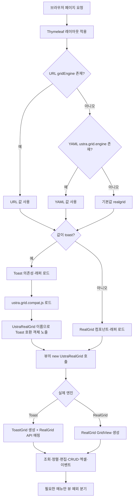
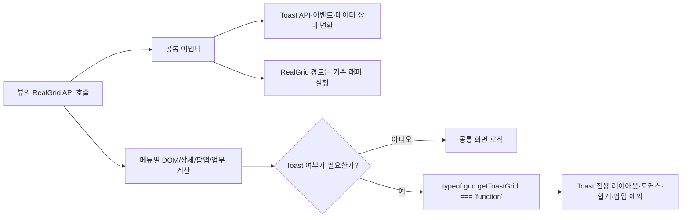

# 그리드 어댑터 이중화 플로우

## 1. 목적

페이지에 접근할 때 YAML 설정과 URL 파라미터를 기준으로 **Toast UI Grid** 또는 **RealGrid** 중 하나만 서버에서 선택해 내려주는 흐름을 정리한다. 화면 템플릿은 기존 `UstraRealGrid` API를 호출하고, Toast 선택 시에만 호환 어댑터가 같은 API를 Toast Grid 동작으로 변환한다.

## 2. 엔진 결정 우선순위

| 우선순위 | 기준 | 예시 | 결과 |
|---:|---|---|---|
| 1 | URL 파라미터 | `/system/standard/view?gridEngine=toast` | 해당 요청만 Toast |
| 1 | URL 파라미터 | `/system/standard/view?gridEngine=realgrid` | 해당 요청만 RealGrid |
| 2 | YAML 설정 | `ustra.grid.engine: toast` | URL이 없을 때 전체 기본 Toast |
| 2 | YAML 설정 | `ustra.grid.engine: realgrid` | URL이 없을 때 전체 기본 RealGrid |
| 3 | 기본값 | 설정 누락 | RealGrid |

구현식은 다음과 같다.

```html
gridEngine = param.gridEngine != null
    ? param.gridEngine[0]
    : (@environment.getProperty('ustra.grid.engine') ?: 'realgrid')
```

`gridEngine == 'toast'`일 때만 Toast 분기로 들어가며, 그 외 값(오탈자 포함)은 RealGrid 분기로 처리된다. YAML을 바꾼 경우 서버 재기동 후 적용되고, URL 파라미터는 재기동 없이 화면별 비교에 사용할 수 있다.

현재 기본 설정:

```yaml
# ustra-hr-system-thymeleaf/src/main/resources/application.yml
ustra:
  grid:
    engine: toast
```

## 3. 페이지 접근부터 그리드 생성까지



## 4. 서버사이드 택일 로드

엔진 선택은 클라이언트에서 두 라이브러리를 모두 로드한 뒤 바꾸는 방식이 아니다. `ustra.realgrid.js`는 최상위 `let UstraRealGrid`를 선언하므로 Toast 어댑터와 함께 로드하면 전역 선언 충돌이 발생한다. 따라서 `footerlayout.html`, `configlayout.html`, `mainconfiglayout.html`의 Thymeleaf 조건에서 스크립트를 택일한다.

### Toast 경로

로드 순서는 고정이다.

```text
tui-time-picker
  → tui-date-picker
  → tui-pagination
  → tui-grid
  → tui-grid.bootstrap.js
  → ustra.toast.grid.components.js
  → ustra.toast.grid.js
  → ustra.grid.compat.js
```

`ustra.grid.compat.js`는 `Grid`, `ToastGrid`, `ToastColumn`이 먼저 존재하는지 확인하고, RealGrid의 식별자인 `UstraRealGridContextMenu`가 이미 있으면 동시 로드를 중단한다.

### RealGrid 경로

Toast 자원과 어댑터를 로드하지 않고 다음 기존 자원을 로드한다.

```html
<script src="/assets/js/ustra-utils/ustra.realgrid.js"></script>
<script src="/assets/js/ustra-utils/ustra.realgrid.components.js"></script>
```

RealGrid 라이선스도 `gridEngine != 'toast'`일 때만 프로필별로 추가된다.

## 5. 뷰 코드가 동일하게 유지되는 이유

화면은 엔진별 생성자를 직접 호출하지 않고 기존 RealGrid 호환 API를 호출한다.

```javascript
var columns = new UstraRealGridColumn()
    .add('code', '코드', 'i18n', 120, false);

var menuGrid = new UstraRealGrid('menuGrid', columns, {
    check: true,
    editable: true
}).build();
```

- RealGrid 선택: `UstraRealGrid`가 실제 RealGrid 래퍼로 동작한다.
- Toast 선택: `ustra.grid.compat.js`의 `UstraRealGrid`/`UstraRealGridColumn`이 생성되고, 내부에 `ToastGrid`를 만든다.
- 화면에서 사용하는 `load`, `focus`, `getRow`, `getData`, `insertRow`, `removeRow`, `setValue`, 이벤트 등록 등은 어댑터가 Toast API로 변환한다.
- 저장·삭제 페이로드, 행 상태(`N/C/U/D`), 컬럼·에디터·렌더러·정렬·병합·엑셀 같은 RealGrid 의미도 어댑터가 가능한 범위에서 재현한다.

즉, 페이지 소스의 기준 계약은 RealGrid API이고, 엔진 선택은 레이아웃과 어댑터 내부에서 끝난다.

## 6. 공통 어댑터와 뷰 예외의 경계



뷰 예외는 다음처럼 Toast 식별 메서드를 조건으로 제한한다.

```javascript
if (typeof menuGrid.getToastGrid === 'function') {
    // Toast에서만 필요한 보정
} else {
    // 기존 RealGrid 동작
}
```

예외가 필요한 대표 상황은 다음과 같다.

- Toast의 `beforeChange` 시점과 RealGrid `onEditCommit` 시점 차이로 인한 합계 중복
- Toast 포커스가 이미 행 변경 이벤트를 발생시켜 합성 클릭이 필요 없는 조직도 화면
- Toast의 상시 세로 스크롤바 예약 폭, `bodyHeight`, iframe 자동 높이 등 DOM 레이아웃 차이
- Toast에서 행이 없을 때 `onCurrentRowChanged`가 발생하지 않아 상세·하위 그리드를 직접 `clear()`해야 하는 경우
- 팝업·셀렉트·버튼 렌더러처럼 화면 DOM과 업무 상세 조회가 함께 묶인 경우

## 7. 요청별 실제 실행 결과

| 요청 | 서버가 내려주는 핵심 자원 | 뷰의 `new UstraRealGrid()` 결과 |
|---|---|---|
| `/menu/view?gridEngine=toast` | TUI Grid + Toast 래퍼 + `ustra.grid.compat.js` | 내부 Toast Grid, 외부 API는 RealGrid 호환 |
| `/menu/view?gridEngine=realgrid` | `ustra.realgrid.js` + RealGrid components | 기존 RealGrid |
| `/menu/view` + YAML `engine: toast` | Toast 경로 | 내부 Toast Grid |
| `/menu/view` + YAML `engine: realgrid` | RealGrid 경로 | 기존 RealGrid |
| YAML 누락 + URL 누락 | 기본 RealGrid 경로 | 기존 RealGrid |

## 8. 확인 방법

같은 메뉴를 다음 두 URL로 열어 엔진별 동작을 비교한다.

```text
/메뉴경로/view?gridEngine=realgrid
/메뉴경로/view?gridEngine=toast
```

개발자 도구의 네트워크/소스에서 다음을 확인하면 택일 로드 여부를 판별할 수 있다.

- Toast 요청: `tui-grid`, `ustra.toast.grid.js`, `ustra.grid.compat.js`가 있고 `ustra.realgrid.js`가 없어야 한다.
- RealGrid 요청: `ustra.realgrid.js`가 있고 `ustra.grid.compat.js`와 Toast 자원이 없어야 한다.
- 두 엔진을 동시에 로드하면 안 된다. 어댑터는 선행 조건 위반을 콘솔에 출력하고 초기화를 중단한다.

## 9. 근거 파일

- 설정: `ustra-hr-system-thymeleaf/src/main/resources/application.yml`
- 엔진 택일 로드: `ustra-hr-system-thymeleaf/src/main/resources/templates/layout/footerlayout.html`
- 라이선스·메인 설정 분기: `ustra-hr-system-thymeleaf/src/main/resources/templates/layout/configlayout.html`, `mainconfiglayout.html`
- Toast 본체: `ustra-hr-system-thymeleaf/src/main/resources/static/assets/js/ustra-utils/ustra.toast.grid.js`
- RealGrid 본체: `ustra-hr-system-thymeleaf/src/main/resources/static/assets/js/ustra-utils/ustra.realgrid.js`
- 호환 어댑터: `ustra-hr-system-thymeleaf/src/main/resources/static/assets/js/ustra-utils/ustra.grid.compat.js`
