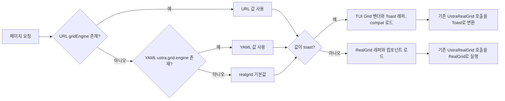

# Toast Grid 내재화 구조 및 예외 처리 현황

> 유관부서 공유용 / 기준일 2026-09-17 / 브랜치 `feature/toast_3차` / 기준 커밋 `87232ca`

## 1. 요약

- 현재 기본 그리드 엔진은 `application.yml`의 `ustra.grid.engine: toast`이다.
- 엔진은 각 그리드 인스턴스마다 정하는 것이 아니라 **HTTP 페이지 요청 단위로 서버의 Thymeleaf 레이아웃에서 한 번 결정**한다.
- 결정 우선순위는 `?gridEngine=...` URL 파라미터 → YAML 설정 → 기본값 `realgrid`이다.
- Toast를 선택하면 기존 메뉴의 `new UstraRealGrid(...)` 코드를 바꾸지 않고, 같은 이름을 노출하는 `ustra.grid.compat.js`가 호출을 받아 TUI Grid 4.21.22로 변환한다.
- 현재 소스 정적 집계 기준으로 그리드 생성자가 있는 템플릿은 983개, `new UstraRealGrid(...)`는 1,259곳, `new UstraRealGridColumn(...)`은 1,331곳이다. 어댑터 도입 당시 주석에 기록된 조사치는 화면 1,045개, 그리드 생성 1,267곳, 컬럼 객체 생성 1,337곳이다.
- 공통 어댑터·Toast 래퍼·Toast 전용 CSS로 대부분의 차이를 흡수하고, 업무 흐름 또는 화면 구조에 종속된 차이는 메뉴 뷰에서 별도 처리했다.
- Toast 관련 커밋 제목을 기준으로 직접 수정된 뷰는 42개 파일, 33개 메뉴·팝업 단위다. 같은 마이그레이션에서 함께 처리한 현재 행 계약 보정 3개 뷰까지 포함하면 **45개 파일, 36개 메뉴·팝업 단위**다.
- 진행 문서상 대부분 메뉴는 아직 `검증 중`이다. 직접 수정 파일 목록은 구현 범위를 뜻하며 전체 업무 시나리오의 완료 선언은 아니다.

## 2. YAML 선언에 따른 동작

### 엔진 선택 규칙

| 우선순위 | 값 | 결과 |
|---:|---|---|
| 1 | URL `?gridEngine=toast` | 해당 요청만 Toast Grid로 렌더링 |
| 1 | URL `?gridEngine=realgrid` | 해당 요청만 RealGrid로 렌더링 |
| 2 | `ustra.grid.engine: toast` | URL 파라미터가 없는 일반 요청은 Toast Grid |
| 2 | `ustra.grid.engine: realgrid` | URL 파라미터가 없는 일반 요청은 RealGrid |
| 3 | 설정 누락 | 기본값 RealGrid |

YAML을 바꾸면 서버 재기동 후 전체 기본 엔진이 바뀐다. URL 파라미터는 재기동 없이 같은 메뉴를 두 엔진으로 비교할 때 사용한다. 구현 조건은 `gridEngine == 'toast'`이고 나머지는 RealGrid 분기로 가므로, 오탈자 등 알 수 없는 값도 결과적으로 RealGrid를 로드한다.



### 선택된 엔진별 로드 파일

| 선택 엔진 | 로드 순서와 역할 |
|---|---|
| Toast | `tui-time-picker` → `tui-date-picker` → `tui-pagination` → `tui-grid` → `tui-grid.bootstrap.js` → `ustra.toast.grid.components.js` → `ustra.toast.grid.js` → `ustra.grid.compat.js` |
| RealGrid | `ustra.realgrid.js` → `ustra.realgrid.components.js` |

두 엔진은 동시에 로드할 수 없다. `ustra.realgrid.js`가 최상위 `let UstraRealGrid`를 선언하고 Toast 호환 어댑터도 같은 이름을 제공하기 때문에 동시 로드하면 전역 이름 충돌이 발생한다. 그래서 브라우저에서 전환하는 방식이 아니라 서버 템플릿에서 한쪽만 내려준다.

### N개 화면이 그대로 동작하는 방식

기존 메뉴는 엔진 종류와 관계없이 다음과 같은 코드를 사용한다.

```javascript
const columns = new UstraRealGridColumn()
    .add(/* 기존 RealGrid 형식 */);

const grid = new UstraRealGrid('gridId', columns, options).build();
```

- RealGrid 분기에서는 기존 RealGrid 래퍼가 이 호출을 처리한다.
- Toast 분기에서는 호환 어댑터가 `UstraRealGrid`와 `UstraRealGridColumn` 이름을 대신 제공한다.
- 화면이 자주 직접 호출하는 `getGrid()`와 `getProvider()`도 어댑터가 RealGrid 모양의 shim을 돌려준다.
- 조회·편집·추가·삭제·저장·정렬·포커스·검증·엑셀 코드는 가능한 한 기존 화면 코드를 유지한다.
- 엔진 차이를 공통으로 재현할 수 없는 경우에만 `getToastGrid` 존재 여부로 Toast 전용 분기를 둔다.

### YAML 분기를 타지 않는 화면

표준 데스크톱 레이아웃을 쓰는 메뉴는 위 분기를 탄다. 다만 현재 템플릿 중 레이아웃 파일을 제외하고 26개가 `ustra.realgrid.js`를 직접 로드한다. 대부분 모바일 화면이며, 레거시 팝업·샘플·`wrkaggrapply`도 포함된다. 이 화면들은 YAML 기본 엔진을 Toast로 바꿔도 RealGrid를 직접 사용한다.

- 모바일 직접 로드 템플릿 23개: `templates/mbl/**`
- 레거시·예외 3개: `popup/system/approval-popup.html`, `sample/modal.html`, `wrk/work/wrkaggrapply.html`

## 3. 내재화 자산

| 자산 | 버전/역할 | 비고 |
|---|---|---|
| `tui-grid` | 4.21.22 / 본체 | MIT, 압축·비압축본 함께 반입 |
| `tui-date-picker` | 4.3.3 / 날짜 편집기 | MIT |
| `tui-time-picker` | 2.1.6 / 시간 편집기 | MIT |
| `tui-pagination` | 3.4.1 / 의존성 | MIT, 현재 페이지네이션 UI는 제한적 |
| SheetJS | 0.20.3 / Excel 가져오기 | 실제 파일 파싱 담당, 사용 시 지연 로드 |
| ExcelJS | 4.4.0 bare / Excel 내보내기 | 헤더 정렬·병합·열폭·숫자 서식, 사용 시 지연 로드 |
| `tui-grid.bootstrap.js` | 프로젝트 작성 부트스트랩 | `window.Grid = tui.Grid` 별칭 제공 |
| `ustra.toast.grid.js` | 프로젝트 Toast 래퍼 | 조회·CRUD·기본 테마·컴포넌트 연결 |
| `ustra.grid.compat.js` | RealGrid 호환 어댑터 | 기존 화면 API와 동작 계약을 Toast로 재현 |

TUI Grid 본체에는 관찰자 콜백 예외가 전체 반응형 큐를 영구 정지시키지 않도록 `flush()`와 `callObserver()`의 정리 코드를 `finally`로 보장하는 벤더 패치 1건이 있다. 버전 업 시 반드시 재적용해야 한다.

## 4. 공통 Toast Grid 어댑터의 예외 처리

아래 항목은 특정 메뉴가 아니라 Toast 엔진을 쓰는 전체 화면 또는 해당 기능을 선언한 전체 화면에 적용된다.

| 구분 | 공통 처리 내용 |
|---|---|
| 로드 안전장치 | TUI Grid·Toast 래퍼 선행 로드를 검사하고 RealGrid와의 동시 로드를 차단한다. 미매핑 호출은 `__gridCompatReport__()`에 누적하며, 중요한 미구현 API는 조용히 오동작하지 않고 명시적으로 예외를 낸다. |
| 컬럼 선언 변환 | RealGrid 컬럼 생성자의 `labelCode` 인자를 흡수하고 텍스트·숫자·날짜·월·콤보·이미지·HTML·버튼·마스크·필수·검증 선언을 TUI 옵션으로 변환한다. |
| 헤더 | 필수 표시, 다단·복합 헤더, 줄바꿈, 정렬 아이콘, 헤더 체크박스, 가운데 정렬, 높이, 글꼴·색상을 RealGrid와 맞춘다. 가상 렌더링으로 헤더가 재생성되어도 표시를 복구한다. |
| 편집 계약 | RealGrid의 편집 전 `onEditCommit` 시점과 취소 반환값을 TUI `beforeChange`에 맞춘다. 셀렉트·여러 줄 편집기의 늦은 커밋, 같은 셀 `setValue` 재진입, 편집 후 신규 행 삽입 전 `finishEditing`을 별도 처리한다. |
| 콤보·룩업 | `values/labels`, `setColumnItems`, `addLookupSource`, 행별 lookup, 표시 라벨 정렬, 편집 가능 조건, 드롭다운 표식을 처리한다. 삭제 후 재사용되는 rowKey 때문에 표식이 사라지지 않도록 DOM 행 속성을 기준으로 다시 계산한다. |
| 이벤트 인자 | `onCurrentRowChanged`, `onEditCommit`, `onEditChange`, `onEditRowChanged`, `onCellEdited`, 클릭·더블클릭·체크 이벤트를 RealGrid의 인자 개수와 `dataRow/itemIndex/field/cellType` 의미로 정규화한다. 빈 현재 행은 `null` 대신 `-1`로 전달한다. |
| 행 상태 | TUI의 `created/updated/deleted`를 `C/U/D`, 원본을 `N`으로 바꿔 `getRow`, `getData`, `getLastRow`, 체크 행, 저장 데이터에 일관되게 넣는다. 강제 상태 지정과 원복 비교도 지원하며 상태 아이콘을 RealGrid SVG와 맞춘다. |
| 데이터 보존 | 부분 `setRow`가 지정하지 않은 필드를 `null`로 지우지 않게 병합한다. 그리드 내부 `_attributes`, 감사 필드 등 화면에 선언되지 않은 값을 저장 페이로드에서 제거한다. 날짜는 서버 계약의 `yyyyMMdd`로 정규화한다. |
| 추가·삭제 | 삽입 API 반환 rowKey, 현재 위치 삽입, 신규 C행 즉시 삭제, 기존 D행 삭제, 삭제 후 다음·이전 행 포커스, 삭제 행 JSON 투영을 RealGrid와 맞춘다. |
| 조회·재조회 | 조회 직후 불필요한 자동 포커스를 없애고, `reload()`의 직전 검색 조건을 기억한다. 데이터 교체 후 체크 가능 조건·행 클래스·계산 필드·표시 콤보를 다시 적용한다. |
| 정렬·포커스 | 정렬 유지·해제, 표시 위치 유지, 정렬 상태에서의 `dataRow` 변환, `setColumns`·lookup 재구성 중 현재 행 보존, 헤더 전체 클릭 정렬, 정렬 후 상세 연동을 보정한다. |
| 포커스 표시·스크롤 | 숨김 첫 컬럼일 때 포커스 테두리를 감추고, 행 단위 스크롤과 마지막 페이지 여백을 RealGrid와 맞춘다. 병합 셀은 블록 테두리와 클릭 행 안쪽 테두리를 별도로 그린다. |
| 레이아웃·크기 | `fitStyle`, 선언 폭, 자동 폭, 동적 컬럼 교체, 좁은 flex 컨테이너, 숨은 탭 재표시, 확대·축소, `fitToParent`, 본문 최소 높이, 헤더·본문·합계 높이를 보정한다. |
| 스크롤바 | 필요할 때만 세로 스크롤바 자리를 쓰고, 트랙을 No. 헤더부터 시작시키며, 가로 스크롤이 없을 때 17px 빈 띠가 마지막 행·합계를 덮지 않게 한다. Shift+휠은 가로, Ctrl+휠은 그리드 미이동으로 처리한다. |
| 고정·이동 | 왼쪽 `fixed.colCount`, 오른쪽 `rightCount`, 고정 열 리사이즈, 상태 열을 포함한 실제 리프 수 환산, 헤더 드래그 이동, 우클릭 현재 열까지 고정을 구현한다. |
| 트리·드래그 | 트리 데이터 변환, 상·하위 행 탐색, 펼침·접힘, 정렬, 가상 스크롤 빈 영역, 명시적으로 행 이동을 켠 화면의 그리드 간 드래그를 보정한다. |
| 병합·그룹·합계 | `mergeRule`을 rowSpan으로 변환하고 스크롤 중 병합 텍스트를 보이는 구간 중앙에 유지한다. 그룹 소계 행, `valueCallback`, footer 합계·평균·text·span, 런타임 footer 변경을 지원한다. |
| 표시 형식 | RealGrid 기본 숫자 형식 `#,##0`, 날짜·텍스트 마스크, prefix/suffix, 셀 style callback, 툴팁, 버튼 정렬, 그리드 글꼴 Pretendard 14px, 헤더·본문·합계 색상을 맞춘다. |
| CRUD 버튼 | 같은 컨테이너에 그리드를 다시 만들 때 이전 jQuery 핸들러를 제거해 중복 확인·중복 요청과 죽은 인스턴스 예외를 막는다. `remove`, `removenoop`, `btnEnable`, 성공·실패 알림 순서를 RealGrid 계약에 맞춘다. |
| 파괴된 인스턴스 | 팝업을 반복해서 열 때 남은 문서 위임 핸들러가 이미 destroy된 그리드를 호출하면 읽기는 빈 결과, 쓰기는 no-op으로 처리하고 진단 카운터를 남긴다. 이후 살아 있는 핸들러가 계속 실행될 수 있게 한다. |
| Excel 가져오기 | SheetJS로 읽고, 숨김 양식 그리드·날짜 포맷·파괴된 팝업 인스턴스·연속 빈 행 삭제를 보정한다. |
| Excel 내보내기 | ExcelJS로 헤더 가운데 정렬, 복합 헤더 병합, 열폭, 숫자 형식, 합계 행, 파일명·시트명을 구성한다. 표시용 `%`, 원화 기호 등은 숫자 셀 서식으로 내보낸다. |

## 5. 현재 알려진 제한과 운영 시 주의사항

| 항목 | 현재 상태/영향 |
|---|---|
| 런타임 페이징 | `_grid.setPaging`은 미구현이며 호출 시 명시적 오류가 난다. `setPage`는 제한적으로 매핑되어 있다. |
| 행 숨김 | provider의 `hideRows`·`showHiddenRows`는 미지원이며 진단 로그만 남긴다. |
| 트리 후손 API | `getDescendantRows`·`getDescendantRowKeys`는 현재 사용처가 없어 미구현이다. |
| 동적 표시 옵션 | 런타임 `vscrollBar`, `selectionStyle`, 체크바 `visible/showAll/mergeRule`, group panel 표시 등 TUI에 대응 API가 없는 설정은 일부 저장 또는 진단만 한다. |
| 동적 grid API | `setCopyOptions`, `setValidations`, `setCheckBar`, `setFooter` 직접 호출은 완전 매핑이 아니다. 화면에서 실제 사용하면 별도 구현 확인이 필요하다. |
| 편집기 | `altEnterNewLine`과 RealGrid multiline 편집기는 완전 호환이 아니며 한 줄 text로 대체되는 경로가 있다. |
| mergeRule | 단순 `criteria: value`는 지원하지만 복합 기준은 근사 처리하며 진단 항목으로 남긴다. |
| dropDownCount | TUI에 동일한 네이티브 옵션은 없지만 어댑터가 항목 높이를 측정해 기본 8개 또는 화면 선언 개수만 보이도록 목록 높이와 스크롤을 보정한다. 진단 집계에도 호출 사실은 남긴다. |
| TUI 테마명 | `Grid.applyTheme('stripped', ...)`는 유효 프리셋명 `striped`의 오타라 TUI default 프리셋으로 폴백한다. 프로젝트 CSS·테마 속성으로 주요 색상은 별도 보정되어 있으나 버전 업 시 정리할 항목이다. |
| 벤더 업그레이드 | TUI Grid 원본 패치 1건과 어댑터의 내부 DOM·store 의존 보정이 있어 단순 파일 교체가 불가능하다. 버전 업 시 재적용과 전체 회귀가 필요하다. |
| 검증 상태 | 진행표의 대부분 메뉴가 `검증 중`이다. 조회·정렬·편집 등 제보 범위는 검증했어도 실제 DB 저장/삭제, 권한, 대량 데이터, Excel을 모두 끝내지 않은 메뉴가 있다. |

미구현·근사 처리 호출은 브라우저 콘솔에서 `__gridCompatReport__()`로 누적 건수와 API명을 확인할 수 있다.

## 6. 직접 수정된 메뉴 뷰 전체 목록

집계 기준은 Toast 내재화 이후 Toast 관련 커밋에서 변경한 템플릿 42개와, 같은 마이그레이션 진행 문서에서 현재 행 이벤트 계약 보정으로 관리한 복리후생 3개 템플릿이다. 공통 어댑터만 변경되어 영향을 받은 메뉴는 이 표의 “직접 수정” 수에 포함하지 않았다.

| 영역 | 메뉴/팝업 | 경로 또는 용도 | 직접 수정 파일 | 화면별 예외 처리 |
|---|---|---|---|---|
| 관리 | 비정형데이터기준 | `/atypical/atypical100/view` | `atypical/atypical100.html` | 신규 행 로컬 삭제 후 같은 위치 포커스 복원, 기준 0건이면 하단 3개 그리드·일련번호 초기화 |
| 교육 | 교육과정관리 | `/edu/edumng/edumngcourse/view` | `edu/edumng/edumngcourse.html` | 추가 시 상세 폼과 현재 행을 함께 해제해 같은 행 재클릭도 상세조회 발생; 두 엔진 공통 화면 결함 수정 |
| 교육 | 교육과정관리 Excel 등록 | 업로드 팝업 | `edu/edumng/edumngcourseupload.html` | Toast에서 양식 생성용 보조 그리드 숨김 |
| 교육 | 교육결과관리 Excel 등록 | 업로드 팝업 | `edu/edumng/edumngedursltmngupload.html` | Toast에서 양식 생성용 보조 그리드 숨김 |
| 관리/인사 | 인사업로드 | `/emp/psmstupload/emppsmstupload100/view` | `emp/psmstupload/emppsmstupload100.html`, `emppsmstuploadtab/emppsmstupload110.html` ~ `190.html` 등 10개 | Toast 저장 성공 직후 현재 탭과 검색 조건으로 명시 재조회; RealGrid의 기존 알림 후 Setting 경로 유지 |
| 인사 | 부서원조회 | `/org/ororgempl/ororgempl270/view` | `org/ororgempl/ororgempl270.html` | Toast 조직도 bodyHeight 고정, 불필요한 세로 스크롤 예약 제거, 검색 조직 포커스 시 좌우 레이아웃 정합 |
| 인사 | 부서연관 | `/org/ororghier/ororghier200/view` | `org/ororghier/ororghier200.html` | 세 영역 flex 폭, 필요 시 스크롤바, 미연관부서→조직도 드래그 좌표·drop 처리 보정 |
| 인사 | 부서이력조회 | `/org/ororglst/ororglst280/view` | `org/ororglst/ororglst280.html` | 최초 행 선택 fallback, Toast 합성 click 제거, 포커스 실패 시 상세 그리드 초기화, 스크롤 폭 정합 |
| 관리 | 부서정보업로드 Excel 등록 | `/org/ororgupload/ororgupload100/view`의 팝업 | `org/ororgupload/ororgexcelupload.html` | 양식 보조 그리드 숨김, 빈 조직코드 행을 실제 rowKey로 일괄 제거 |
| 관리 | 부서연관업로드 Excel 등록 | `/org/ororgupload/ororgupload120/view`의 팝업 | `org/ororgupload/ororgexcelupload120.html` | `type="hidden"`이 div를 숨기지 못하는 차이를 보정해 양식 보조 그리드 숨김 |
| 관리 | 급여군관리 | `/pay/paypbas/paypbas140/view` | `pay/paypbas/paypbas140.html` | 마스터 삭제 후 다음·이전 잔존 행으로 포커스 복원, 0건이면 상세와 버튼 상태 초기화 |
| 관리 | 급여설정관리 | `/pay/paypbas/paypbas210/view` | `pay/paypbas/paypbas210.html` | 줄바꿈 헤더가 있어도 실제 RealGrid와 같은 40px 헤더를 Toast 옵션으로 명시 |
| 관리 | 급여지급정보업로드 Excel 등록 | `/pay/payupload/payupload100/view`의 팝업 | `pay/payupload/payuploadpopup100.html` | Toast에서 양식 다운로드용 보조 그리드 숨김 |
| 급여 | 사업소득자관리 | `/pay/paywht/pr630/view` | `pay/paywht/pr630.html` | 신규 행의 실제 rowKey로 포커스, Toast 상세 폼 전송 상태를 서버의 PUT 신규 계약에 맞춤 |
| 급여 | 일용소득자관리 | `/pay/paywht/pr632/view` | `pay/paywht/pr632.html` | 신규 행 실제 rowKey 포커스와 상세 폼 전송 상태 보정 |
| 급여 | 외국법인소득자등록 | `/pay/paywht/pr633/view` | `pay/paywht/pr633.html` | 신규 행 실제 rowKey 포커스와 상세 폼 전송 상태 보정 |
| 급여 | 사업소득지급명세 | `/pay/paywht/pr640/view` | `pay/paywht/pr640.html` | 마스터/상세 flex·toolbar·날짜 열·버튼 레이아웃, Toast overflow 보정; 편집 중 동일 셀 선반영에 따른 합계 2배 방지 |
| 급여 | 기타소득지급명세 | `/pay/paywht/pr641/view` | `pay/paywht/pr641.html` | 지급명세 공통 레이아웃 보정과 편집 중 동일 셀 선반영에 따른 합계 2배 방지 |
| 급여 | 이자배당소득지급명세 | `/pay/paywht/pr641b/view` | `pay/paywht/pr641b.html` | 지급명세 공통 레이아웃·overflow 보정 |
| 급여 | 연간이자배당지급명세 | `/pay/paywht/pr641byear/view` | `pay/paywht/pr641byear.html` | 상단 합계표·버튼·그리드 클래스 분리, 복합 헤더 80px와 상세 헤더 60px/bodyHeight를 Toast에서 명시 |
| 급여 | 일용소득지급명세 | `/pay/paywht/pr642/view` | `pay/paywht/pr642.html` | 지급명세 공통 마스터/상세 레이아웃·overflow 보정 |
| 급여 | 외국법인소득지급명세 | `/pay/paywht/pr643/view` | `pay/paywht/pr643.html` | 지급명세 공통 마스터/상세 레이아웃·overflow 보정 |
| 급여 | 주민세 종업원분 | `/pay/paywht/pr671/view` | `pay/paywht/pr671.html` | 빌드 전에 합계 숫자 형식 지정, 과세/비과세 영역 1:1 폭, 최종 flex 폭에서 fill 재적용 |
| 공통 팝업 | 주소검색 | 사업장·근무지 등 공용 | `popup/psmst/address-pop.html` | 3줄 주소가 잘리지 않고 한 화면 약 5행이 보이도록 Toast 결과 행 높이를 66px로 지정 |
| 공통 팝업 | 공통코드검색 | 원천세 화면 등 공용 | `popup/psmst/cdbase-pop.html` | 2열 fill 팝업에서 Toast의 불필요한 가로 스크롤 비활성화 |
| 결재 | 대결자관리 | `/system/aprvtransfer/view` | `system/aprvtransfer.html` | 미저장 신규 대결자 삭제를 서버 호출 없이 로컬 제거하고 shadow row와 선택 상태 정리 |
| 관리 | 부서조회권한등록 | `/system/deptinquiry/view` | `system/deptinquiry.html` | 저장·삭제 시작 시 사용자/역할/검색 조건 보관, 알림으로 포커스가 빠져도 명시 재조회·하단 초기화 |
| 관리 | 업무별권한등록 | `/system/roles/deptuser/view` | `system/roles/deptuser.html` | 저장·삭제 후 선택 역할과 사용자명 조건으로 Toast 목록 명시 재조회 |
| 시스템 | 프로그램관리 | `/system/pgmbas/view` | `system/pgmbas.html` | 정렬·정렬 해제 후 현재 행의 상세 폼과 버튼 상태를 다시 동기화 |
| 시스템 | 업무기준관리 | `/system/standard/view` | `system/standard.html` | 정렬 유지 상태 재조회 시 조회순번 0이 아니라 표시 첫 행의 dataRow를 계산해 포커스 |
| 근태 | 특별휴가관리 | `/wrk/wrkleav/wrkleavemng100/view` | `wrk/wrkleav/wrkleavemng100.html` | 화면 표시는 정수로 유지하고 Excel에만 RealGrid와 같은 최대 두 자리 소수 형식 적용 |
| 관리 | 연차부여개수업로드 | `/wrk/wrkupload/wrkuploadyear100/view` | `wrk/wrkupload/wrkuploadyear100.html` | 선택 시점 D 페이로드 선생성, C행 로컬 제거, 서버 성공 뒤 재조회, 0건·실패 분기 처리 |
| 관리 | 근태내역관리(근태코드) | `/wrk/wrkupload/wrkuploaddesc100/view` | `wrk/wrkupload/wrkuploaddesc100.html` | 연차 업로드와 같은 Toast 삭제 순서 적용, 빈·잘못된 삭제 요청과 재노출 방지 |
| 복리후생 | 복리후생신청 | `/wlf/welfaremng/welfaremng110/view` | `wlf/welfaremng/welfaremng110.html` | 현재 행 해제 이벤트에서 `add()`를 다시 호출하던 분기를 제거해 추가·재선택 흐름 안정화 |
| 복리후생 | 의료비신청 | `/wlf/wlfmemng/wlfmemng200/view` | `wlf/wlfmemng/wlfmemng200.html` | 현재 행 해제 이벤트의 재귀성 `add()` 호출 제거 |
| 복리후생 | 학자금신청 | `/wlf/wlfstuapply/wlfstuapply111/view` | `wlf/wlfstuapply/wlfstuapply111.html` | 현재 행 해제 이벤트의 재귀성 `add()` 호출 제거 |

### 인사업로드 10개 실제 파일

1. `emp/psmstupload/emppsmstupload100.html`
2. `emp/psmstupload/emppsmstuploadtab/emppsmstupload110.html`
3. `emp/psmstupload/emppsmstuploadtab/emppsmstupload120.html`
4. `emp/psmstupload/emppsmstuploadtab/emppsmstupload130.html`
5. `emp/psmstupload/emppsmstuploadtab/emppsmstupload140.html`
6. `emp/psmstupload/emppsmstuploadtab/emppsmstupload150.html`
7. `emp/psmstupload/emppsmstuploadtab/emppsmstupload160.html`
8. `emp/psmstupload/emppsmstuploadtab/emppsmstupload170.html`
9. `emp/psmstupload/emppsmstuploadtab/emppsmstupload180.html`
10. `emp/psmstupload/emppsmstuploadtab/emppsmstupload190.html`

## 7. 공통 변경으로 영향을 받지만 뷰를 직접 수정하지 않은 대표 메뉴

직접 뷰 변경 목록만 보면 적용 범위가 작아 보일 수 있다. 아래 메뉴들은 화면 파일을 건드리지 않고 공통 어댑터·Toast 래퍼·CSS 수정으로 동작이 바뀌거나 회귀 확인된 대표 사례다.

- 임원퇴직지급률, 개인별정기수당조회·등록
- 급여반영내역확인, 전월대비급여조회, 급여변경내역조회
- 계약서배포·계약서관리, 휴직자관리
- 평균근속기간, 연차발생기준등록, 계속근로자 인터페이스
- 복리후생설정, 학자금승인·급여반영, 의료비급여반영
- MY진행중문서, 문서양식관리, 문서양식별결재선관리
- 급여코드관리, 비과세/감면코드관리, 장기수당기준관리, 급여명세서계산식관리, 일할계산기준관리
- 공통코드관리, 사업장관리, 근무지관리, 직급·직위·직책·발령코드
- 급여업로드·급여계좌업로드

## 8. 유관부서 전달 시 권장 표현

“YAML 한 곳에서 전체 기본 엔진을 선택하고, 같은 메뉴는 URL 파라미터로 RealGrid와 Toast를 즉시 비교할 수 있습니다. 기존 약 1천 개 화면의 `UstraRealGrid` 코드는 유지하며, Toast 선택 시 공통 호환 어댑터가 API와 동작 차이를 흡수합니다. 공통화하기 어려운 업무 흐름과 레이아웃만 45개 뷰 파일에서 별도 보정했습니다. 현재 기본값은 Toast이며, 주요 제보 범위는 수정·대조했지만 전체 메뉴의 저장·삭제·권한·대량 데이터·Excel 검증은 진행 중입니다.”
